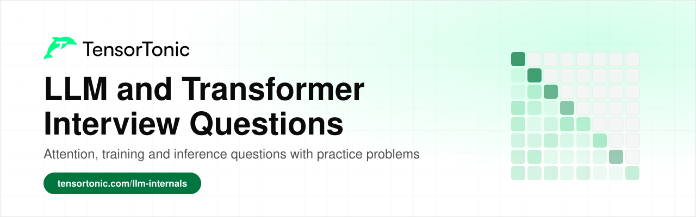
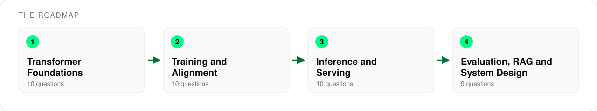

# LLM and Transformer Interview Questions

  

This is a list of the transformer and large language model questions that come up most often in ML engineer and research interviews. It has 39 questions across four stages, from tokens and attention to serving, evaluation and system design.

Every question links to an explanation that covers the answer and to practice problems where you implement the idea in Python and check it against tests. Having built attention or a KV cache yourself is the most reliable way to answer follow-up questions about them.

## Table of Contents

- [Who this is for](#who-this-is-for)
- [How to use this roadmap](#how-to-use-this-roadmap)
- [Stage 1: Transformer Foundations](#stage-1-transformer-foundations)
- [Stage 2: Training and Alignment](#stage-2-training-and-alignment)
- [Stage 3: Inference and Serving](#stage-3-inference-and-serving)
- [Stage 4: Evaluation, RAG and System Design](#stage-4-evaluation-rag-and-system-design)
- [What's next](#whats-next)

## Who this is for

This list is for anyone preparing for an interview where transformers or LLMs are likely to come up.

- If you are **preparing for an ML engineer role**, focus on stages 1 and 3, since attention, the KV cache and serving questions are the most common.
- If you are **interviewing for research or post-training roles**, spend extra time on stage 2, where training dynamics and alignment methods are covered.
- If you already **work with LLMs**, use the tables as a self-test and read the explanations only for the questions you cannot answer out loud.

You need basic Python and some familiarity with neural networks. The questions build on each other, so earlier stages make later answers easier.

## How to use this roadmap

Read each question and try to answer it out loud in two minutes before opening the explanation. Interviewers usually follow up with a trade-off or a number, so check that your answer covers why the idea exists and what it costs.

After reading, solve one of the practice problems for that question. When you have finished a stage, the [interview assessments](https://www.tensortonic.com/assessments) let you test yourself under time pressure, including the [LLM Internals](https://www.tensortonic.com/assessments/re-llm-internals), [Training and Decoding Primitives](https://www.tensortonic.com/assessments/re-training-decoding) and [Post-Training and Alignment](https://www.tensortonic.com/assessments/re-post-training-alignment) sets.

## Stage 1: Transformer Foundations

Almost every LLM interview starts with how a transformer turns text into predictions. These questions cover tokens, positions, attention and the block that repeats through the whole model. Expect to explain each one from scratch and to say how modern models changed the original design.

| Question | Read | Practice |
| --- | --- | --- |
| What is tokenization, and how is a BPE tokenizer trained and applied? | [Tokenization in the Transformer](https://www.tensortonic.com/research/transformer/transformers-tokenization) | [Train a BPE Tokenizer From Scratch](https://www.tensortonic.com/problems/cs336-l01-train-byte-pair-encoding), [Apply Ranked BPE Merges](https://www.tensortonic.com/problems/cs336-l01-apply-bpe-merge-ranks) |
| Why do transformers need positional information, and how does RoPE encode it? | [RoPE: Rotary Position Embedding Explained](https://www.tensortonic.com/llm-internals/rope) | [RoPE: Rotary Query and Key Embeddings](https://www.tensortonic.com/problems/cs336-l03-rotary-query-key-embeddings), [Sinusoidal Positional Encoding](https://www.tensortonic.com/problems/positional-encoding) |
| How does self-attention work, and why are the scores scaled by the square root of the key dimension? | [Attention in LLMs: Queries, Keys and Values Explained](https://www.tensortonic.com/llm-internals/attention-mechanism) | [Named-Dimension Batched Attention Scores](https://www.tensortonic.com/problems/cs336-l02-einsum-attention-scores), [Numerically Stable Softmax](https://www.tensortonic.com/problems/softmax-function) |
| What is the causal mask, and where in attention is it applied? | [Attention in LLMs: Queries, Keys and Values Explained](https://www.tensortonic.com/llm-internals/attention-mechanism) | [Causal Masking for Attention](https://www.tensortonic.com/problems/causal-masking) |
| Why use multiple attention heads, and what do MQA and GQA change? | [Multi-head attention in the Transformer](https://www.tensortonic.com/research/transformer/transformers-multi-head-attention) | [Causal Grouped-Query Attention](https://www.tensortonic.com/problems/cs336-l03-causal-grouped-query-attention) |
| Walk through a decoder block. Where do the residual connections and normalization go? | [Encoder block in the Transformer](https://www.tensortonic.com/research/transformer/transformers-encoder-block) | [Transformer Decoder Block](https://www.tensortonic.com/problems/dl-decoder-block) |
| Why do transformers use LayerNorm instead of BatchNorm, and what does RMSNorm remove? | [Layer Normalization in the Transformer](https://www.tensortonic.com/research/transformer/transformers-layer-normalization) | [RMSNorm Forward Pass](https://www.tensortonic.com/problems/cs336-l03-rmsnorm-forward) |
| What does the feed-forward layer do, and why does a SwiGLU block use a smaller hidden size? | [Feed-forward network in the Transformer](https://www.tensortonic.com/research/transformer/transformers-feed-forward) | [Parameter-Matched SwiGLU Block](https://www.tensortonic.com/problems/cs336-l03-parameter-matched-swiglu) |
| What is the difference between encoder-only, decoder-only and encoder-decoder models, and why did decoder-only win for LLMs? | [GPT Pretraining: How Next-Token Prediction Works](https://www.tensortonic.com/llm-internals/gpt-pretraining) | |
| What is a Mixture of Experts model, and what goes wrong when you train one? | [Mixture of Experts (MoE) in LLMs Explained](https://www.tensortonic.com/llm-internals/mixture-of-experts) | [Top-k MoE Router with Load Statistics](https://www.tensortonic.com/problems/cs336-l04-topk-moe-router) |

## Stage 2: Training and Alignment

Once the architecture is clear, interviewers move on to how the model is trained and how a base model becomes an assistant. These questions cover the pretraining objective, optimization, memory and scale, and the fine-tuning and preference methods used after pretraining.

| Question | Read | Practice |
| --- | --- | --- |
| What is the pretraining objective of a GPT-style model, and what does perplexity measure? | [GPT Pretraining: How Next-Token Prediction Works](https://www.tensortonic.com/llm-internals/gpt-pretraining) | [Cross-Entropy Loss](https://www.tensortonic.com/problems/cross-entropy-loss), [Perplexity Computation](https://www.tensortonic.com/problems/perplexity-computation) |
| What is the difference between Adam and AdamW, and why does it matter for LLMs? | [Which Optimizer to Use in Deep Learning](https://www.tensortonic.com/guides/which-optimizer-to-use) | [AdamW (Decoupled Weight Decay)](https://www.tensortonic.com/problems/adamw-optimizer) |
| Why do LLMs use learning-rate warmup, and what schedule follows it? | | [Warmup + Linear Decay LR Schedule](https://www.tensortonic.com/problems/warmup-decay-lr), [Generate a Warmup-Stable-Decay Schedule](https://www.tensortonic.com/problems/cs336-l11-wsd-learning-rate) |
| Your training loss suddenly spikes or turns into NaN. What do you check first? | [Training Loss Not Decreasing? Causes and Fixes](https://www.tensortonic.com/guides/training-loss-not-decreasing) | [Gradient Clipping (Global Norm)](https://www.tensortonic.com/problems/gradient-clipping) |
| What is mixed-precision training, and why is bf16 usually preferred over fp16? | [Mixed Precision Training: FP16 vs BF16](https://www.tensortonic.com/llm-internals/mixed-precision) | [Mixed-Precision Training Memory Accountant](https://www.tensortonic.com/problems/cs336-l02-training-memory-accountant) |
| What do scaling laws say about how to split compute between model size and data? | [GPT Pretraining: How Next-Token Prediction Works](https://www.tensortonic.com/llm-internals/gpt-pretraining) | [Recover an IsoFLOP Compute-Optimal Frontier](https://www.tensortonic.com/problems/cs336-l09-isoflop-optimal-frontier) |
| How do data parallelism and ZeRO reduce the memory needed per GPU? | [Gradient Accumulation in LLM Training](https://www.tensortonic.com/llm-internals/gradient-accumulation) | [Account for ZeRO Memory by Stage](https://www.tensortonic.com/problems/cs336-l08-zero-memory-accounting), [Synchronize Data-Parallel Gradients](https://www.tensortonic.com/problems/cs336-l07-data-parallel-gradient-sync) |
| How does LoRA work, and what does QLoRA add on top of it? | [LoRA in LLMs: Beginner's Guide to Fine-Tuning](https://www.tensortonic.com/llm-internals/lora), [QLoRA Explained: 4-Bit LLM Fine-Tuning](https://www.tensortonic.com/llm-internals/qlora) | |
| Walk through RLHF. How does DPO reach a similar goal without a separate reward model? | [RLHF Explained: Reward Models and PPO](https://www.tensortonic.com/llm-internals/rlhf), [DPO: Direct Preference Optimization Explained](https://www.tensortonic.com/llm-internals/dpo) | [DPO Loss](https://www.tensortonic.com/problems/cs336-l15-direct-preference-optimization-loss) |
| What is GRPO, and why does it not need a value network? | [GRPO: Group Relative Policy Optimization](https://www.tensortonic.com/llm-internals/grpo) | [Normalize GRPO Group Advantages](https://www.tensortonic.com/problems/cs336-l16-grpo-group-advantages) |

## Stage 3: Inference and Serving

Serving questions are now common even for roles that do not focus on infrastructure, because cost and latency decide whether a model ships. These questions cover how tokens are generated, why decoding is slow, and the techniques that make it faster and cheaper.

| Question | Read | Practice |
| --- | --- | --- |
| How do temperature, top-k and top-p change the way the next token is sampled? | | [Temperature, Top-k, and Top-p Sampling](https://www.tensortonic.com/problems/inference-token-sampling) |
| What is the KV cache, and why does it speed up generation? | [KV Cache in LLMs: How It Makes Inference Fast](https://www.tensortonic.com/llm-internals/kv-cache) | [Decode Attention with a KV Cache](https://www.tensortonic.com/problems/cs336-l10-kv-cache-decode-step) |
| How do you estimate the KV cache size for a given model and context length? | [KV Cache in LLMs: How It Makes Inference Fast](https://www.tensortonic.com/llm-internals/kv-cache) | [Plan KV-Cache Capacity](https://www.tensortonic.com/problems/cs336-l10-kv-cache-capacity-planner), [Calculate KV Cache Memory for MHA, MQA, GQA, and MLA](https://www.tensortonic.com/problems/inference-kv-cache-memory) |
| How do prefill and decode differ, and why is decode limited by memory bandwidth? | [What Is Inference Engineering? How to Learn It](https://www.tensortonic.com/guides/inference-engineering) | [Analyze Prefill and Decode with the Roofline Model](https://www.tensortonic.com/problems/inference-prefill-decode-roofline) |
| What is FlashAttention, and is its output exact? | [FlashAttention Explained: Tiling and Memory](https://www.tensortonic.com/llm-internals/flash-attention) | [Blockwise Online Softmax](https://www.tensortonic.com/problems/cs336-l05-blockwise-online-softmax) |
| What is quantization, and does INT4 give a four times speedup over FP16? | [LLM Quantization Explained: INT8, INT4, GPTQ and AWQ](https://www.tensortonic.com/llm-internals/quantization) | [Symmetric INT8 Quantization](https://www.tensortonic.com/problems/inference-symmetric-int8-quantization), [Group-Wise INT4 Quantization](https://www.tensortonic.com/problems/inference-groupwise-int4-quantization) |
| What problem does PagedAttention solve? | [PagedAttention Explained: KV Cache Blocks](https://www.tensortonic.com/llm-internals/paged-attention) | [PagedAttention Block Allocation](https://www.tensortonic.com/problems/inference-paged-attention-allocation) |
| What is the difference between static and continuous batching? | [LLM serving and RAG](https://www.tensortonic.com/ml-design/llm-serving) | [Simulate Continuous Decode Batching](https://www.tensortonic.com/problems/cs336-l18-continuous-batching-scheduler) |
| How does speculative decoding work, and why does it give the same distribution as the target model? | [Speculative Decoding in LLMs Explained](https://www.tensortonic.com/llm-internals/speculative-decoding) | [Perform Exact Speculative Sampling](https://www.tensortonic.com/problems/cs336-l10-speculative-sampling) |
| Which metrics would you track for an LLM serving system? | [Latency, throughput, and cost](https://www.tensortonic.com/ml-design/latency) | [Compute TTFT, TPOT, ITL, and Token Throughput](https://www.tensortonic.com/problems/inference-serving-metrics) |

## Stage 4: Evaluation, RAG and System Design

Later rounds ask whether you can judge a model and build a product around it. These questions cover evaluation, retrieval-augmented generation, the live coding round and open-ended design prompts.

| Question | Read | Practice |
| --- | --- | --- |
| How do you evaluate an LLM when there is no single correct answer? | [Evaluating generated answers](https://www.tensortonic.com/ml-design/generative-evaluation) | [Fit Elo Ratings from Pairwise Votes](https://www.tensortonic.com/problems/cs336-l12-pairwise-elo-fit) |
| How would you measure agreement between human or LLM judges? | [Machine Learning Evaluation Metrics](https://www.tensortonic.com/guides/ml-evaluation-metrics) | [Cohen's Kappa](https://www.tensortonic.com/problems/cohens-kappa) |
| What is benchmark contamination, and how would you detect it? | | [Build Deterministic MinHash Signatures](https://www.tensortonic.com/problems/cs336-l14-minhash-signatures) |
| What is RAG, and what happens between the user's question and the model's answer? | [Retrieval-Augmented Generation (RAG) Explained](https://www.tensortonic.com/llm-internals/rag) | [Text Chunking for RAG](https://www.tensortonic.com/problems/text-chunking) |
| What is the difference between dense and sparse retrieval, and when would you combine them? | [Retrieval-Augmented Generation (RAG) Explained](https://www.tensortonic.com/llm-internals/rag) | [BM25 Ranking](https://www.tensortonic.com/problems/bm25) |
| How do you evaluate a RAG system, and how do you tell a retrieval failure from a generation failure? | [LLM serving and RAG](https://www.tensortonic.com/ml-design/llm-serving) | [Precision and Recall at K](https://www.tensortonic.com/problems/precision-recall-at-k) |
| In a coding round, how would you implement multi-head attention from scratch? | [ML Coding Interview Questions: 20 to Implement](https://www.tensortonic.com/guides/ml-coding-interview-questions) | [Multi-Head Attention (MHA)](https://www.tensortonic.com/problems/inference-multi-head-attention) |
| How would you design a support chatbot that answers from company documentation? | [ML System Design Interview Framework](https://www.tensortonic.com/ml-design/interview-framework) | |
| How would you serve a large open model to thousands of concurrent users within a latency target? | [LLM serving and RAG](https://www.tensortonic.com/ml-design/llm-serving) | [Optimize Throughput and Cost Under a Latency SLO](https://www.tensortonic.com/problems/inference-throughput-cost-slo) |

## What's next

To go deeper than single questions, the [Build LLM from Scratch](https://www.tensortonic.com/study-plans/language-modeling-from-scratch) study plan walks through a full language model piece by piece, and the [Inference Engineering](https://www.tensortonic.com/study-plans/cracking-inference) plan covers serving in the same way. The [LLM Internals](https://www.tensortonic.com/llm-internals) pages have visual explanations of most topics above, and the [Transformer research track](https://www.tensortonic.com/research/transformer/transformers-attention) rebuilds the original paper step by step.

If you want to build the model yourself instead of studying it one question at a time, the [How to Build an LLM from Scratch](https://www.tensortonic.com/guides/build-an-llm-from-scratch) guide walks through the stages in order, from tokens and embeddings to generation, and lists the mistakes people make when joining the pieces.

For a written walkthrough of how to prepare, the [LLM Interview Questions](https://www.tensortonic.com/guides/llm-interview-questions) guide explains how to answer the questions interviewers ask most often about large language models.

## License

MIT
